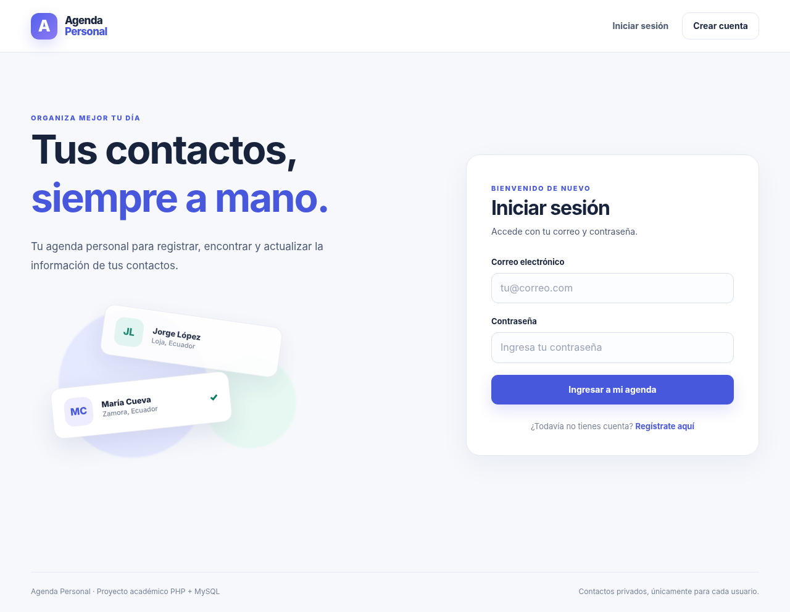

# Agenda Personal de Contactos — Versión 2.0 (APE B1)

Aplicación web en **PHP + MySQL** para registrar usuarios, autenticar sesiones y administrar **únicamente sus propios contactos**. La versión 2 amplía el proyecto del primer foro con las **cuatro mejoras** de la actividad APEB1: búsqueda, ordenamiento, categorías y favoritos. El código está preparado para XAMPP y un hosting Apache/PHP como InfinityFree.

> **Estado de publicación:** los archivos están preparados, pero el despliegue real depende de una cuenta externa. URL pública a sustituir **después** de publicar y comprobar: `https://TU-SUBDOMINIO.infinityfreeapp.com/` (es un ejemplo, NO es una URL activa). No afirmar funcionamiento público hasta verificarlo desde otro navegador.

## Funcionalidades y diferencias frente a V1

| Funcionalidad | V1 (foro) | V2 (actividad APEB1) |
|---|---|---|
| Registro, login y logout | Sí | Se mantiene |
| CRUD de contactos privados | Sí | Se mantiene |
| Búsqueda por nombre, correo y ciudad | No | Sí, con consulta preparada |
| Orden por nombre, ciudad y fecha | Solo nombre | Sí; ascendente/descendente |
| Categorías | No | Sí: Familia, Amigos, Trabajo, Universidad y Otro |
| Contactos favoritos | No | Sí: agregar, quitar y filtrar solo favoritos |
| Filtro combinado | No | Sí: texto + categoría + favoritos + orden |
| Despliegue en hosting | Solo local | Paquete específico para InfinityFree |

### Seguridad que no se pierde con las mejoras

- Contraseñas mediante `password_hash()` / `password_verify()`; correo único en MySQL.
- Sesiones regeneradas al autenticar; caducidad por inactividad; cookies HttpOnly, SameSite=Lax, Secure cuando HTTPS.
- Consultas preparadas con **PDO** y `id_usuario` **procedente de la sesión** para lectura, búsqueda, conteo, edición, favoritos y borrado.
- Verificación de propiedad y respuesta 404 si se manipula el ID de un contacto de otro usuario.
- Protección CSRF en formularios POST; escapado HTML de la salida; validación en servidor.
- Ordenamientos limitados a una lista blanca de columnas/direcciones; los `%` y `_` de búsquedas se tratan como texto literal.
- Carpetas privadas protegidas en Apache por `.htaccess` y credenciales locales ignoradas por Git.

## Tecnologías

PHP 8.1+ (PDO MySQL, sesiones, openssl, filter), MySQL 8+ o MariaDB 10.6+, HTML5, CSS3, Apache y XAMPP (para Windows). No usa bibliotecas externas de ejecución ni JavaScript obligatorio.

## Requisitos para ejecución

- PHP con `pdo_mysql` habilitado; Apache con `mod_rewrite` para acceder al proyecto desde su raíz en hosting.
- Servidor MySQL/MariaDB con permisos para crear tablas y claves externas.
- Navegador web actualizado, y conexión HTTPS para la publicación.
- Copiar `config/config.example.php` a `config/config.php` y ajustar los parámetros reales; no subir esa copia a GitHub.

## Instalación local en XAMPP — base nueva

1. Descomprime este proyecto en `C:\xampp\htdocs\agenda_personal_php`.
2. Inicia **Apache** y **MySQL** en XAMPP. Si el puerto 3306 está ocupado, resuelve el conflicto o cambia el puerto de MySQL (por ejemplo a 3307), y ajusta `config/config.php` al mismo puerto.
3. En `http://localhost/phpmyadmin`, importa **solo** `database/agenda_personal_v2_local.sql` en una instalación **nueva**. Crea la base `agenda_personal`, las tablas `usuarios`, `categorias` y `contactos`, además de las cinco categorías.
4. Copia `config/config.example.php` como `config/config.php`; edita `host`, `port`, `database`, `username` y `password` conforme a tu MySQL.
5. Abre `http://localhost/agenda_personal_php/public/`; registra dos usuarios y verifica que los contactos de uno no aparezcan en el otro.
6. Comprueba las cuatro mejoras en el panel. Para instrucciones visuales consulta [DESPLIEGUE_INFINITYFREE.md](docs/DESPLIEGUE_INFINITYFREE.md).

### Si YA instalaste la V1 con contactos reales

**No importes el SQL de instalación nueva sobre una base V1.** Primero exporta una copia de seguridad con phpMyAdmin. Después importa **una sola vez** `database/migracion_v1_a_v2_local.sql` sobre la base existente. La migración conserva usuarios y contactos; asigna `Otro` (ID 5) y `favorito=0` a los contactos antiguos. La fecha de creación de contactos anteriores quedará registrada al migrar, ya que V1 no almacenaba ese dato. El script usa `ALTER TABLE`: MySQL confirma cambios DDL automáticamente, por lo que el respaldo previo es obligatorio.

## Publicación en hosting gratuito (InfinityFree)

1. Crea tu cuenta y sitio desde https://www.infinityfree.com/; anota el subdominio HTTPS y las credenciales MySQL proporcionadas **por el panel**.
2. Crea la base en el panel y abre el phpMyAdmin del proveedor. Selecciona la base correcta e importa `database/agenda_personal_v2_hosting.sql` (**no** contiene `CREATE DATABASE` ni `USE`). Si la base ya estaba en V1, importa en su lugar la migración `migracion_v1_a_v2_hosting.sql`, tras exportar un respaldo.
3. Descomprime el archivo independiente `Agenda_Contactos_V2_Hosting_InfinityFree.zip` y sube **el contenido de su carpeta `htdocs`**, incluidas las carpetas privadas y el archivo oculto `.htaccess`, a `/htdocs` de tu sitio. **No subas el ZIP entero sin extraer ni uses la carpeta `public` como raíz sin el archivo .htaccess de arriba.**
4. En el hosting, dentro de `/htdocs/config/`, copia `config.example.php` a `config.php` y configura nombre exacto, host, usuario y contraseña de MySQL del panel; el puerto normalmente es 3306, salvo que el proveedor indique otro. El archivo está protegido por Apache y nunca va al repositorio.
5. Elimina la página `index.html` predeterminada del proveedor si oculta la aplicación. Abre `https://TU-SUBDOMINIO.infinityfreeapp.com/` (**sustituye por tu dirección real**).
6. Verifica registro, login, CRUD, búsqueda, orden, categorías, favoritos, logout y acceso prohibido a contactos de otra cuenta; comprueba HTTPS y que `/config/config.php` no pueda descargarse. Guarda capturas reales.
7. Copia el enlace público definitivo a este README, reemplazando el marcador de arriba y la plantilla del texto de entrega.

La guía detallada, con solución de problemas y lista de comprobación, está en [docs/DESPLIEGUE_INFINITYFREE.md](docs/DESPLIEGUE_INFINITYFREE.md).

## Estructura

```text
agenda_personal_php/
├── .htaccess                        # Regla Apache para usar public/ como entrada
├── config/                          # Bootstrap y plantilla de credenciales (privado)
├── src/                             # Autenticación, consultas, validaciones, seguridad
├── templates/                       # Vistas reutilizables
├── public/                          # Archivos web accesibles
│   ├── index.php, login.php, registro.php, logout.php
│   ├── dashboard.php                # Buscar, ordenar, filtrar
│   ├── contacto_nuevo.php, contacto_editar.php, contacto_eliminar.php
│   ├── contacto_favorito.php         # Alternar favorito con POST + CSRF
│   └── assets/css/styles.css
├── database/
│   ├── agenda_personal_v2_local.sql
│   ├── agenda_personal_v2_hosting.sql
│   ├── migracion_v1_a_v2_local.sql
│   └── migracion_v1_a_v2_hosting.sql
├── tests/                            # Pruebas simuladas, HTTP, estáticas y MySQL
├── docs/                             # Guías, capturas y lista de entrega
└── README.md
```

## Modelo de datos V2

- `usuarios (id, nombre, correo, password, fecha_registro)`.
- `categorias (id, nombre)`: 1 Familia, 2 Amigos, 3 Trabajo, 4 Universidad, 5 Otro.
- `contactos (id, id_usuario, nombre, telefono, correo, ciudad, id_categoria, favorito, fecha_creacion)`.
- `contactos.id_usuario` referencia a `usuarios.id` con borrado en cascada; `contactos.id_categoria` referencia a `categorias.id` con restricción de borrado. Cada contacto exige categoría válida.

## Capturas de pantalla

> Son **capturas del sistema real**, no imágenes inventadas. La carpeta `docs/capturas/` incluye representaciones visuales de las respuestas HTML/CSS de login y registro generadas por PHP local; no demuestran conexión MySQL ni despliegue público. Las imágenes del panel con datos personales deben **añadirse tras ejecutar y probar MySQL**; consulta las instrucciones de captura en [docs/CAPTURAS.md](docs/CAPTURAS.md).




Capturas pendientes por realizar en tu instalación: `03_dashboard_filtros.png`, `04_contacto_formulario.png`, `05_favoritos.png` y `06_url_https.png`. **No declararlas completadas hasta capturarlas realmente.**

## Pruebas y verificación

```bash
php tests/unit.php
php tests/form_render.php
python tests/static_audit.py
# En otra terminal: php -S 127.0.0.1:8765 -t public
python tests/http_smoke.py
# Requiere PDO MySQL, config/config.php y SQL V2 instalados:
php tests/mysql_integration.php
```

Las suites unitarias usan un PDO **simulado**; las pruebas de rutas HTTP sin login no necesitan base; `mysql_integration.php` prueba contra un MySQL **real** dentro de una transacción y deshace datos temporales. **No debe afirmarse que la integración real está probada hasta ejecutarla con éxito.** Registro de resultados y alcance en [docs/PRUEBAS_V2.md](docs/PRUEBAS_V2.md).

## Entrega académica

La actividad pide **URL pública**, **repositorio GitHub** actualizado y **script SQL**. Revisa [docs/CHECKLIST_APEB1.md](docs/CHECKLIST_APEB1.md) y [docs/TEXTO_ENTREGA_APEB1.md](docs/TEXTO_ENTREGA_APEB1.md) para completar los enlaces reales. Este ZIP **no publica por sí solo** un sitio ni crea un repositorio.
